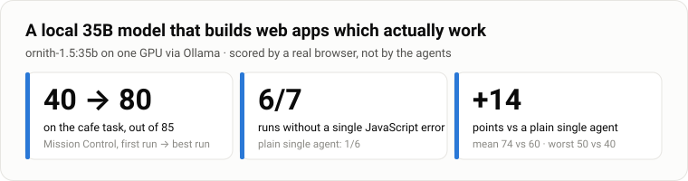
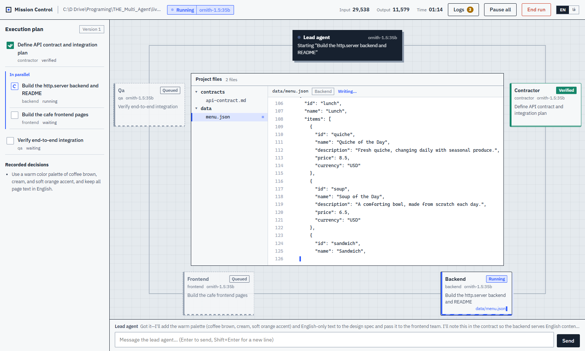
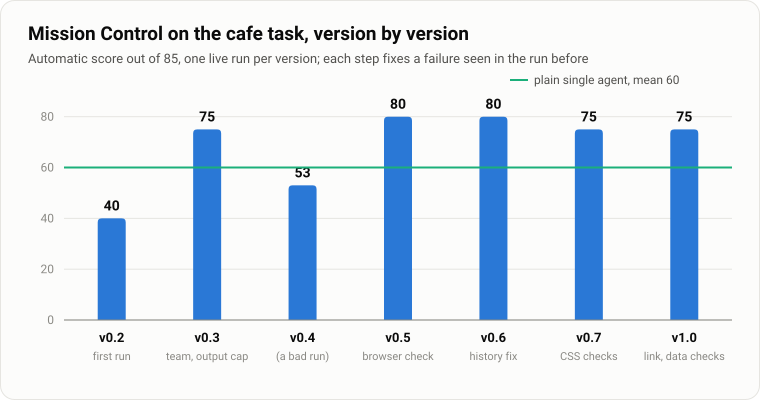
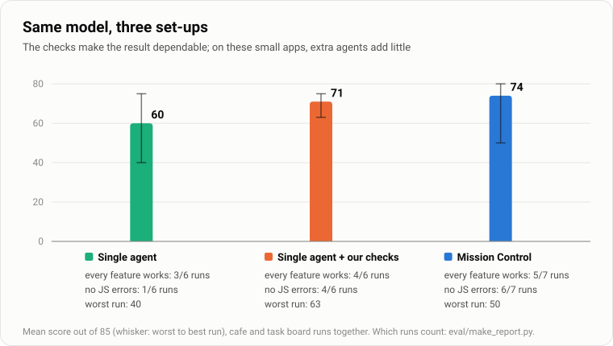
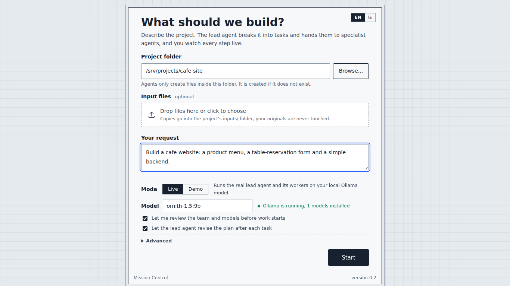
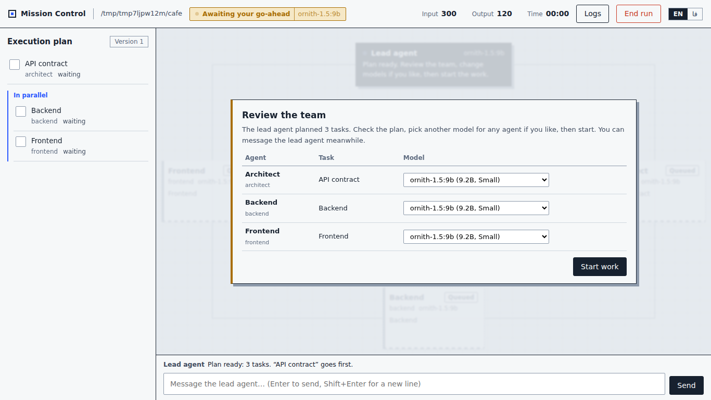
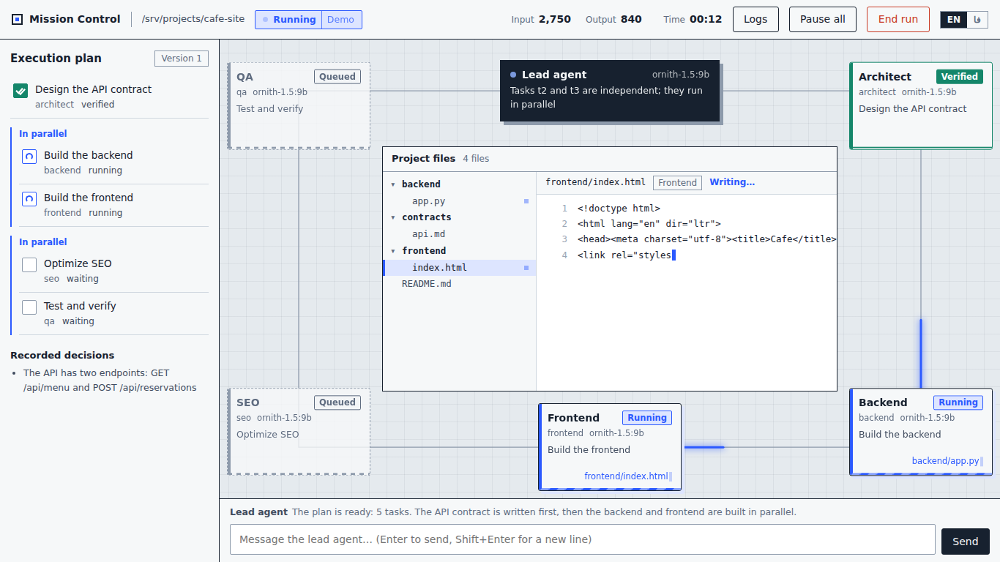
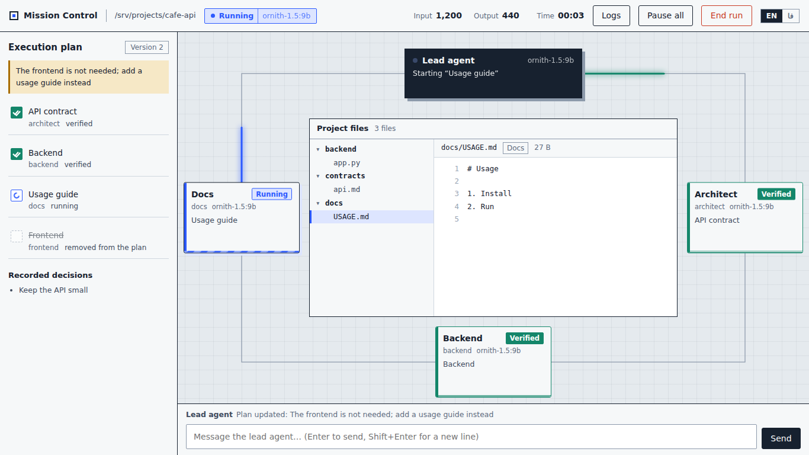
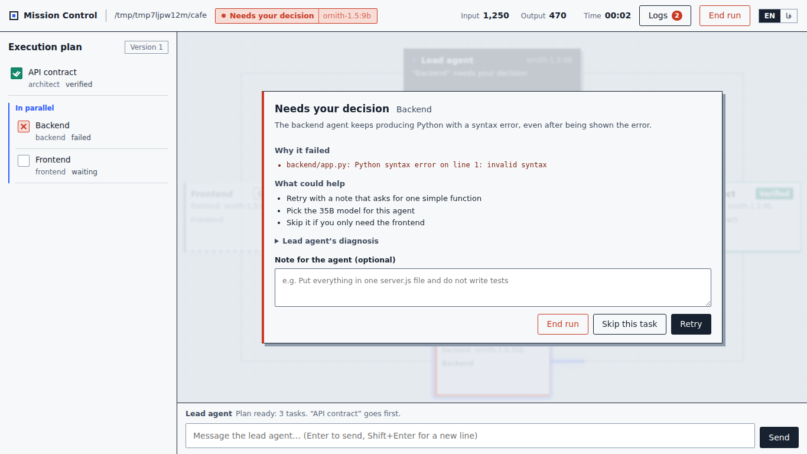
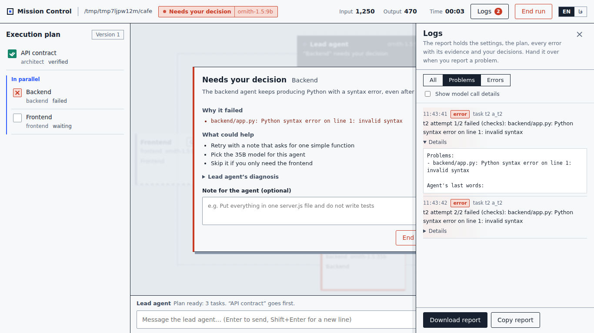

# Mission Control

[](https://github.com/devhosein/THE_Multi_Agent/actions/workflows/ci.yml)
[](LICENSE)


A multi-agent orchestrator with a live, graphical **operations room**. You describe a project; a *lead agent* breaks it
into a validated plan and creates one specialist agent per task. You review the team (and pick a model per agent),
then watch the work happen: tasks run in dependency order, every result is checked, failures are diagnosed and rescued
by the lead, the plan is revised while the run is in progress, and every agent answers your messages at any moment.
Runs on local models through [Ollama](https://ollama.com).

## Results



The same local model (`ornith-1.5:35b`, one GPU), the same prompts, scored by a **real browser** that uses the site
like a person: open the pages, read the menu, book a table, add / complete / delete a task (`eval/`, rubric written
before the runs). What took Mission Control from **40 to 80 out of 85** is a verification layer that runs the
project after every task and sends what is broken back to the agent that owns it — and every step of that climb
comes from a failure seen in a live run ([`docs/FAILURES.md`](docs/FAILURES.md), 22 of them).







**What the verification layer checks**, with the standard library only: it starts the backend, loads every page,
follows every link, fetches every script, stylesheet and image, calls every API the pages call, checks CORS, element
ids, CSS classes and variables, and that data files and API answers agree. With Playwright installed it also uses the
pages in a real browser: JavaScript errors, data that never reaches the page, forms that do nothing, unreadable text.

**What we learned, honestly.** Give a *single* agent the same checks and it does almost as well on these small apps
(71 vs 74): the gain comes from verification, not from the number of agents, and Mission Control is slower (minutes
per run: about 12 vs 9 vs 3). Multi-agent pays off for large or parallel work, for a reviewer that did not write
the code, and for mixing a strong lead with cheap local workers — the next things to measure. Each number is a small
sample (6–7 runs per set-up over two tasks); every run, every caveat and the excluded runs are in
[`eval/results/README.md`](eval/results/README.md).

| Start | Review the team, pick models | Two agents at work (demo) |
|---|---|---|
|  |  |  |
| **The lead changes the plan mid-run** | **A task failed: you decide** | **Logs and a shareable report** |
|  |  |  |

## Run it (Windows, macOS, Linux — Python ≥ 3.11, nothing to install)

```powershell
python scripts/serve.py            # opens http://127.0.0.1:8765
```

- **Live** runs the real engine on your Ollama model (default `ornith-1.5:9b`); the start screen checks Ollama and the
  model first. **Demo** plays a recorded six-agent run, whatever you type.
- **Browse…** opens your operating system's own folder dialog (fallback: a built-in browser). Pasted paths are tidied
  (`"C:\My Folder\"` from *Copy as path*, `%USERPROFILE%`, `~`, `file:///…`).
- **Advanced**: model strength (Auto picks Small/Medium/Large from the model size) and an optional context window.
  By default Mission Control sets **no context limit** — Ollama decides.
- English UI by default, Persian (right-to-left) one click away.

Headless: `python scripts/run_engine.py --project C:\tmp\cafe --prompt "Build a cafe website" --approve-plan`

## What the engine does

```
prompt ─► plan (validated DAG) ─► one agent per task ─► your go-ahead (models per agent)
  ─► for each ready task: worker with sandboxed tools ─► checks ─► verified
        failed? ─► more attempts with the exact problems ─► the lead diagnoses: retry with guidance or split the task
                   ─► still failing? you decide: retry (with a note), skip, or stop
  ─► the lead reviews the remaining plan after each task ─► … ─► done   (and "Retry failed tasks" later if needed)
```

- **Rules live in code, not prompts**: agents can only write the files their task owns, inside the project folder.
- **Built for real local models** (lessons from live runs in `docs/FAILURES.md`): transient model errors are retried
  without losing the attempt; cut-off tool calls are recovered (smaller history, files written in parts); loops are
  detected and stopped with a diagnosis; strength profiles give weaker models more scaffolding instead of weakening the
  engine for strong ones.
- **You stay in charge**: pause/stop at safe points; message any agent and it answers right after its current step
  (instructions go into a shared decision ledger, questions just get an answer).
- **Everything is observable**: the UI is a pure function of an event log (`docs/EVENTS.md`); the Logs panel shows
  every warning/error with evidence; **Download report** produces a Markdown diagnosis to hand over.
- **Safe local server**: 127.0.0.1 only, Host/Origin checks, model text never rendered as HTML.

## Tests

| command | covers | count |
|---|---|---|
| `python -m unittest discover -s tests -t .` | engine (scripted model), engine over the real Ollama HTTP protocol, tools sandbox, server, SSE, security, paths, report, translations, scripts, repo hygiene | 305 |
| `node --test tests/ui_state.test.mjs` | the UI's event reducer | 16 |
| `python tests/e2e_ui.py` | real browser (`pip install playwright && playwright install chromium`; or `--browser msedge` to use an installed Edge): layouts in both languages, live run, approval, replan, failure decision, logs, report, retry, Persian text in code | 124 checks |

Critical logic is mutation-tested (bugs injected on purpose must make a test fail). CI runs the unit and reducer
tests on Ubuntu and Windows (Python 3.11 and 3.13) and the browser checks on Ubuntu, on every push.

## Documentation
- `CLAUDE.md` — working notes for continuing in Claude Code (commands, architecture, rules).
- `docs/HANDOFF.md` — the complete story: vision, research, roadmap and status, architecture, testing, limits, next steps.
- `docs/FAILURES.md` — failures seen in real runs and how the engine handles them.
- `eval/` — the benchmark: tasks and rubrics, browser-based scorers, the runner, every scored run.
- `docs/EVENTS.md` — the event contract.
